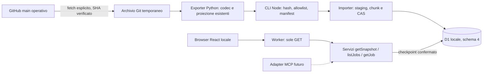
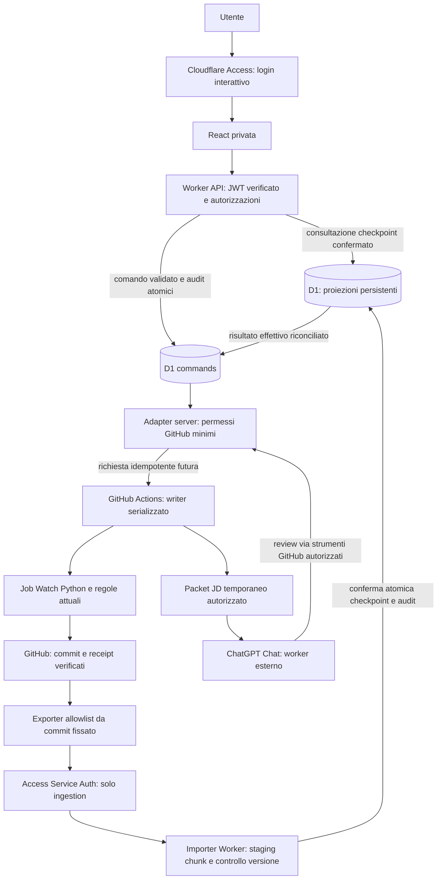

# Responsabilità e flussi

## Confine attuale

La Fase 1 implementa Git a commit fissato → exporter isolato → bundle allowlist → importer CLI → D1 reale locale → servizi dati → Worker/React locali. Nessun componente scrive nell'autorità operativa. Browser e API sono compilati separatamente; solo contratti puri sono condivisi.

`tools/local-sync.mjs` è il confine Git/Python; `worker/data/importer.ts` riceve soltanto bundle sanitizzati. La CLI usa getPlatformProxy con binding remoto disabilitato. Le funzioni query accettano D1 e DTO validati, senza oggetti HTTP/provider SDK: il futuro MCP non dovrà duplicare SQL o regole. Il trasporto MCP e l'autenticazione non sono implementati.

## Target V1, ancora da implementare

Le frecce future non dichiarano capacità già disponibili: l'adapter mutativo e la selezione arbitraria non esistono ancora. ChatGPT non è invocato dall'app tramite API; il browser può in futuro aprire un contesto esplicito con metadati minimi e URL, mai JD o credenziali nei query parameter.

## Distribuzione delle responsabilità

- GitHub/Python: unica autorità V1 per regole, configurazione, ciclo di vita, decisioni, fingerprint, alias, certificazione e azioni operative.
- D1: livello di consultazione durevole e storico delle versioni osservate, più intenti dei comandi e audit. Non sovrascrive lo stato operativo prima dell'ACK. Le review semantiche e le decisioni utente hanno tabelle diverse.
- Worker: verifica identità, autorizzazione, validazione, limiti di input, accesso D1 indicizzato e adapter GitHub server-only. In Fase 1 health e consultazione, con runtime remoto bloccato.
- Frontend: mostra freschezza/provenienza/stato tecnico, raccoglie intenzioni, non decide regole o completamento. Nessun accesso GitHub diretto o segreto.
- Importer locale: allowlist per file e campi; codec memoria verificato; snapshot versionati e checkpoint CAS. L'import di file non equivale a pubblicazione.
- CI nuova: verifica esclusivamente nuova app e schema locale, read-only, senza secret, artifact o cloud.

## Schema e consistenza

`companies`, `sources`, `jobs` sono identità durevoli. `company_versions`, `source_versions`, `job_versions` portano metadati e provenienza per snapshot: un import parziale non sovrascrive i dati visibili. I riferimenti alle identità non vengono cancellati quando le vacancy chiudono. `job_aliases` conserva chiavi legacy confermate senza fondere aziende diverse.

`sync_snapshots` e `sync_chunks` registrano staging, integrità e completamento dei chunk. `sync_checkpoints` contiene la revisione attiva: solo snapshot confermati. Le letture partono dal checkpoint e filtrano tutte le versioni per quell'ID; mai `max(timestamp)` su dati in staging. I dati identità da staging non sono consultabili senza join al checkpoint.

`semantic_reviews` e `user_decisions` sono eventi deduplicati per hash del risultato decodificato; la review è legata al fingerprint, la scelta utente all'identità. Le letture eventi usano le appartenenze snapshot_semantic_reviews/snapshot_user_decisions a snapshot confermati e ordinano timestamp/precedenza Python. Il risultato effettivo va portato dall'exporter, non ricalcolato nel browser. Le tabelle non contengono JSON libero o JD. Le colonne legacy per riepiloghi rimangono nulle: la Fase 1 esclude motivazioni libere e dati personali, conservando soltanto campi strutturati e hash del risultato completo decodificato.

`pipeline_runs` distingue ID GitHub, attempt, run hash di pipeline e flag di completamento. `commands` memorizza intenti immutabili e stato del trasporto; `audit_log` è append-only con riferimenti e codici, senza payload. Il database è un supporto, non un confine completo di sicurezza: importer e adapter devono ancora validare autorizzazione, hash, antenati Git e corrispondenza dei risultati prima di finalizzare.

UTC in SQL/API; calendario di retry esistente Europe/Rome conservato come policy Python. Niente cancellazioni a cascata delle identità o dei registri storici. Indici per snapshot/batch/stato/azienda, history per job e coda comandi. Application tracker e MCP richiederanno migrazioni successive.

## Limiti locali e crescita

Il bulk import gira in Node, non in una richiesta Worker. Budget per invocazione e ripresa chunk proteggono la pubblicazione, ma non misurano la quota aggregata di un account Cloudflare. La Fase 2 deve introdurre contabilità giornaliera, riduzione delle versioni invariate/retention e misure CPU Worker reali: il bootstrap osservato supera le 100.000 scritture Free/giorno. Non abilitare sync remota continuativa sulla sola base di queste verifiche locali. Query e contatori sono reali; metriche SQL della pagina non includono le query di contesto/provenienza.
