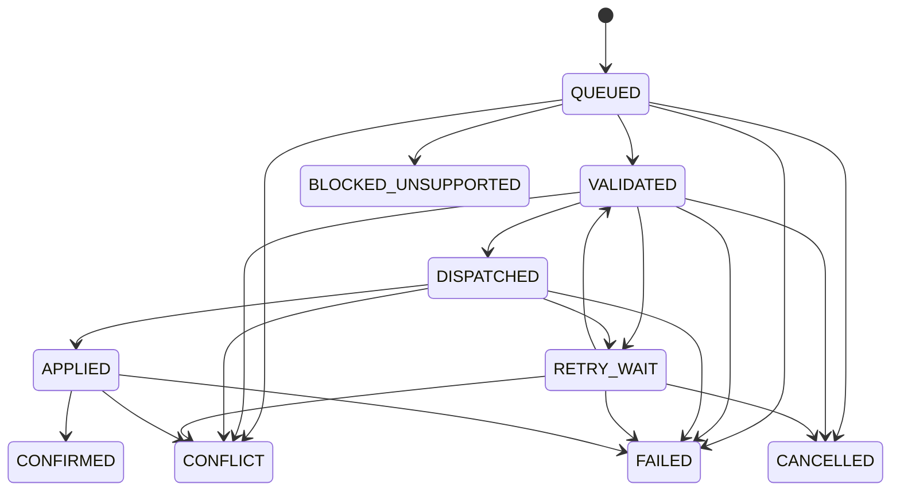

# Contratto di sincronizzazione v1 (progetto, non attivo)

Stato: contratto documentato e schemi di input testati. In Fase 0 non esistono importer GitHub, endpoint ingestion, dispatcher, polling, accesso D1 remoto o autenticazione remota attiva. `POST /api/commands` risponde 501. Gli schemi condivisi non conferiscono autorizzazione a scrivere.

## Identificatori e versioni

- Repository fisso `giacodmr/job-watch-milano`; branch autorevole main. Ogni import legge blob dal medesimo commit SHA completo, mai da URL main mutevoli tra una richiesta e l'altra.
- `company_id`: stringa `company:<id>` derivata dall'id config esistente e conservata dopo eventuale rename. Candidati senza id ricevono ID deterministico separato `candidate:<sha256(nome esatto)>`; promozione richiede mapping esplicito, non fuzzy matching.
- `job_id`: assegnato deterministicamente alla prima chiave ufficiale, `job:<sha256(company_id + NUL + job_key)>`, e non cambia con routing batch o source ID. `job_key` originale `Company::source_id` conservato; chiavi successive entrano in `job_aliases` solo da risoluzione Python verificata o conferma manuale. Nome società/URL da soli non autorizzano fusioni. Le collisioni ambigue fermano il record e non cancellano evidenze.
- `source_id`: `source:<sha256(company_id + NUL + logical_source_key)>`. La logical key identifica provider e board/tenant ufficiale, non URL con tracking o batch. Cambio URL è una versione, cambio tenant una fonte distinta, da confermare.
- Fingerprint Python: stringa opaca, distinta dagli hash SHA-256 di file; conservare metodo/provenienza. Non rigenerarla nella web app.
- `snapshot_id`: `snapshot:<sha256(repository + NUL + commit_sha + NUL + manifest_sha256)>`. Non coincide con run_id pipeline o batch_snapshot worker. Conservare questi token separatamente quando necessari a un comando.
- Review/decision ID deterministico da job_id + hash canonico del risultato decodificato completo (non del solo riepilogo). Stesso risultato letto in un altro commit non crea un evento duplicato. D1 conserva una sintesi allowlist e riferimenti, non l'intero documento sorgente.
- Versione protocollo: 1. Versione schema DB: 2 dopo 0001/0002. `sync_checkpoints.revision` e `commands.revision`: interi monotoni per compare-and-swap; non sono timestamp o SHA. Ogni cambio protocollo incompatibile richiede nuova versione e test.
- Nuovi hash web: SHA-256, UTF-8, rappresentazione canonica RFC 8785 dei JSON con chiavi controllate; array manifest files ordinato per path, chunks per indice. L'implementazione canonica sarà scelta/testata in Fase 1. Gli hash Python preesistenti si trattano come token, senza imitarne serializzazione in JavaScript. Byte hash di file e packet si calcolano sui byte originali, non su JSON riparsato.

## GitHub → D1

1. Leggere HEAD una volta e verificarne appartenenza alla linea autorizzata. Confrontare con checkpoint precedente: stesso commit/manifest è no-op; commit antecedente è ignorato; storia divergente richiede riconciliazione, mai last-write-wins per timestamp. Un commit discendente senza cambi ai file allowlist può avanzare solo metadati checkpoint, senza riscrivere tutti i record.
2. Manifest `manifestSchema`: repository, commitSha, observedAt UTC, lista file con path, SHA-256 byte e dimensione; lista chunk contigui da 0 con hash e conteggio. Path e campi strict; nessuna JD, token o artifact nel manifest. La lista deve essere **completa per lo scope di import**: quattro inventari/memorie/ATS, configurazioni, archivi esistenti e stati richiesti. Lo schema valida la forma, l'importer valida completezza, hash e dimensioni.
3. Estrazione allowlist: configurazioni aziende/routing/fonti; tutti i job metadata nei current; identità di tutte le memorie e degli archivi; review/decisioni decodificate e sintesi; status ATS e pipeline. Daily è dato aggiuntivo per azionabilità, mai la base dell'inventario. Non trasferire interi file sorgente o JSON liberi all'API. In particolare il file Amazon viene letto solo dall'exporter con allowlist, non copiato in D1/browser.
4. Conservare i codec/regole esistenti per espansione `$e`, alias e proiezione. Nessuna chiamata a collect/sync/project o fetch JD nell'exporter. Funzioni di proiezione Python possono registrare errori su input malformati: eseguirle soltanto su copia temporanea del checkout, mai sul working tree autorevole; idealmente introdurre wrapper read-only in Fase 1 con test di non scrittura.
5. Creare snapshot STAGING. Ogni chunk ha idempotency `(snapshot_id, index)` e hash; replay identico è no-op, contenuto diverso → 409. In ogni D1 batch atomico inserire identità mancanti, versioni/eventi e marker chunk solo dopo validazione completa del chunk. Non usare upsert che sovrascriva eventi confermati. Limite iniziale: 20 statement e massimo 80 parametri per statement, corpo 128 KiB, record bounded; misurare righe/CPU e dividere ulteriormente. Niente `BEGIN` distribuiti tra invocazioni: usare D1 `batch` per atomicità locale.
6. Finalizzazione: ricontrollare manifest, conteggi, chunk, foreign key, alias e policy. In un solo batch con guardie CAS verificare revisione attesa, confermare snapshot, avanzare checkpoint e inserire audit. Se il CAS fallisce, fallisce **tutto** il batch: una UPDATE che modifica 0 righe non basta. Usare un'asserzione SQL che abortisca il batch o un adapter verificato equivalente. I trigger SQL richiedono chunk contigui e impediscono checkpoint su STAGING; l'importer deve anche verificare hash/contenuti e antenati Git.
7. Reader: partire da checkpoint e usare quell'ID per tutte le versioni. Non mostrare righe STAGING/FAILED, non prendere l'ultima data globale. Eventi deduplicati sono visibili solo se lo snapshot d'origine è confermato; confrontare la loro provenienza con la versione interrogata per evitare futuri eventi in una vista storica. Non mostrare dati identità orfani dal solo staging.
8. Import interrotto: checkpoint precedente resta visibile, chunk identici ripetibili. Snapshot confermato immutabile; staging abbandonato marcato FAILED e ripulibile in seguito. Rollback remoto futuro: nuova revisione checkpoint verso uno snapshot confermato verificato, audit esplicito; nessuna riscrittura dei dati GitHub.

I trigger Fase 0 non sono un importer completo: non verificano il contenuto del manifest, la compatibilità dell'exporter, l'immobilità di ogni tabella eventi o la genealogia Git. Questi controlli appartengono all'adapter e sono criteri obbligatori di Fase 1, prima di un import reale.

## Web → comando → GitHub → conferma

L'input `commandSchema` accetta soltanto versione, command UUID, idempotency key, commit/manifest/fingerprint attesi, batch/jobKey e un tipo noto. `user_decision` aggiunge stato, motivo breve e categoria; `request_semantic_review` non accetta una patch semantica dal browser. Actor e timestamp affidabili vengono dal server autenticato, mai dal body. Verifica ulteriore Python resta necessaria, inclusa coerenza tra categoria e motivo.

Validazione futura: autenticazione utente, scope, same-origin/CSRF, dimensione body, JSON strict, job appartenente al batch corrente, snapshot confermato, fingerprint corrente, motivi espliciti, nessun campo JD, nessun testo sensibile. Il limite a 360 caratteri non è un rilevatore di PII: la UI deve chiedere solo motivi pertinenti e l'adapter applica allowlist. Nessun payload completo in audit/log.

Idempotency key globale per questo servizio personale, legata ad actor e hash payload: stessa chiave/stesso actor/hash restituisce lo stesso comando; hash o actor diverso → 409, senza divulgare il contenuto altrui. UUID command e request_id bridge distinti, con mapping stabile salvato prima di ogni tentativo. Creazione comando + audit è atomica. Il browser riceve un'intenzione accodata, non uno stato operativo applicato.

- QUEUED: intenzione persistita, ancora non applicata. VALIDATED: regole/precondizioni verificate e adapter disponibile. BLOCKED_UNSUPPORTED: capacità mancante, nessun tentativo di aggirarla.
- DISPATCHED: richiesta esattamente identificata pubblicata e run/evento correlato; il solo HTTP 2xx non attesta applicazione.
- APPLIED: risultato specifico per record presente in receipt immutabile e commit remoto confermato; hash receipt e SHA conservati. Successo workflow, SELECT READY e APPLY PARTIAL non equivalgono a completamento del comando.
- CONFIRMED: successiva sync D1 verificata include un commit uguale o discendente di quello applicato, receipt identica e valori effettivi corrispondenti. Soltanto qui la UI può mostrare «completato». Se il risultato è stato superato da altra scelta utente, mostrare CONFLICT e storia, non rispedire automaticamente l'intento obsoleto.
- FAILED/CONFLICT/CANCELLED/BLOCKED_UNSUPPORTED/CONFIRMED sono terminali per quell'intento; nuovo intento e nuova chiave per cambiare obiettivo. Nessuna cancellazione remota implicita di un comando già DISPATCHED.

Le transizioni SQL bloccano salti e richiedono commit/receipt per APPLIED e checkpoint confermato per CONFIRMED. L'adapter deve verificare davvero uguaglianza risultato, genealogia Git e receipt: la sola presenza dei campi non è una prova. Revisioni di stato e audit devono cambiare nella stessa transazione, con CAS contro worker concorrenti.

## Adapter disponibili e capacità mancanti

Bridge attuale v2: SELECT dalla coda batch (1–20, fetch=true, exclusions bounded), poi APPLY legato a packet/snapshot/receipt. `expected_job_key` è un'asserzione sul primo risultato. Non esiste una selezione diretta per jobKey, né una mutation generica di aziende o scelte utente. Inoltre il trigger è push su main di un solo request JSON per push: non basta chiamare workflow_dispatch, e un commit generato da GITHUB_TOKEN potrebbe non attivare workflow successivi. Un futuro adapter deve scegliere una GitHub App/credenziale autorizzata e testare il trigger, senza scritture attive in questa fase.

I nuovi tipi di comando non sono attualmente eseguibili. Fino a un'estensione separata e verificata restano disabilitati; una richiesta arbitraria di analisi va BLOCKED_UNSUPPORTED, non simulata con una lunga lista di esclusioni. Le decisioni Daily hanno fingerprint/timestamp/rigetti parziali: usare l'entrypoint corretto in un adapter dedicato e verificare esito per singola vacancy.

## Conflitti, retry e conferma

- Precondizioni: commit base e manifest attesi per intenzione utente, più fingerprint e versione dei dati correnti; per worker semantico valgono anche batch_snapshot e packet hash. Nuova raccolta o modifica memoria → rivalutazione, mai rebase silenzioso di una review stale.
- Scelte utente durano secondo Python attraverso fingerprint e alias; scelte concorrenti sono ordinate solo dopo controllo timestamp corrente. Nessun automatico sovrascrive APPLIED/NOT_INTERESTED. Review semantiche vecchie rimangono storiche; hard exclusion e scarto semantico non diventano user decisions.
- Errori transitori: backoff con jitter 30s, 2m, 10m, 30m, massimo 5 tentativi totali, rispettando Retry-After e quota. Prima di ripetere un dispatch incerto cercare receipt/request/run/commit con lo stesso ID. Non creare un altro intento per un timeout. Il retry del trasporto è separato da `jd_retry.py`: nessun aggiramento del limite 4 fetch falliti o della data Europe/Rome.
- Errori permanenti schema/autorizzazione: FAILED con codice redatto; snapshot/fingerprint/alias ambiguo: CONFLICT; capacità non supportata: BLOCKED_UNSUPPORTED. Packet scaduto: nuova selezione e revisione esplicita, senza riutilizzare giudizio privo della sua evidenza canonica.
- Scrittura GitHub rifiutata perché main avanzato: rileggere fonte e verificare precondizioni; serializzare con il writer esistente e niente force push. Riconciliare push riuscito/ACK perso tramite antenato remoto e uguaglianza receipt come il runner esistente.
- Stale checkpoint o D1 indisponibile: lasciare l'intento APPLIED in attesa di sync, non rieseguire l'azione già verificata; esporre freschezza degradata. Nessun flag globale COMPLETE derivato da una singola health web.

## Audit, conservazione e autenticazione

Audit append-only: event_code, actor_ref opaco, entity/command/snapshot ID, hash e UTC; niente body, JD, email o raw error. Chunks falliti e retry con codici tecnici; fonte originale resta un path Git a commit verificato, accessibile solo tramite strumenti autorizzati. L'audit D1 non è un archivio WORM contro l'amministratore del DB.

Decisioni e identità chiuse non si cancellano automaticamente. History D1 inizia dalla prima osservazione; import passato da Git history separato. Policy retention per versioni e limiti storage da misurare prima di sync remota; nessuna eliminazione cieca per rientrare in quota.

Interattivo: Cloudflare Access + JWT validato + allowlist utente. Servizio: Access Service Auth separato, sola ingestion; secret custoditi lato server/CI. In futuro `/api/sync/*` non accetta cookie utente come ruolo servizio né viceversa. Nessun secret VITE_, accesso diretto GitHub browser, query URL con JD o LLM API. Requisiti dettagliati in ADR 0001.
